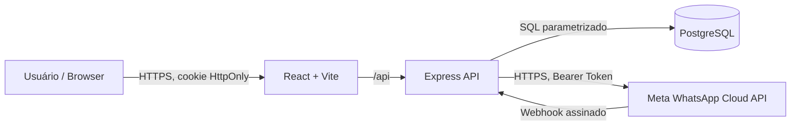

# Arquitetura — ClinicFlow

## Visão de módulos

## Multi-tenancy

- Cada organização possui `organizations.id` UUID.
- `users.organization_id` vincula cada usuário ao workspace; a sessão identifica o usuário.
- Todos os endpoints de dados aplicam `organization_id` derivado **exclusivamente da sessão autenticada**, nunca do corpo HTTP fornecido pelo cliente.
- Dados são separados logicamente no mesmo banco. Para produção, avaliar políticas de Row Level Security (RLS) e testes de isolamento como defesa adicional.
- Uma `whatsapp_channels` por organização; cada `phone_number_id` é único globalmente. O webhook consulta essa tabela para identificar o workspace.
- Códigos HTTP 404 são retornados para recursos de outros workspaces.

## Fluxo de login

1. Usuário apresenta e-mail e senha.
2. Senha é comparada com hash bcrypt, e uma sessão aleatória de 32 bytes é criada.
3. Somente o hash SHA-256 do token de sessão é armazenado no PostgreSQL.
4. O token é enviado em cookie `HttpOnly`, `SameSite=Lax`, `Secure` em `NODE_ENV=production`.
5. O middleware valida token e expiração para cada rota privada.

## WhatsApp

- **Demo (`WHATSAPP_MODE=mock`)**: mensagens são registradas com `status=simulated`; nenhuma requisição à Meta.
- **Live (`WHATSAPP_MODE=live`)**: exige canal configurado por workspace, consentimento e mensagem recebida nas últimas 24 horas.
- Access token é armazenado com AES-256-GCM, usando `APP_ENCRYPTION_KEY` no ambiente do backend.
- GET webhook valida `hub.verify_token` e devolve `hub.challenge`.
- POST webhook usa `express.raw` antes do parser JSON, calcula HMAC-SHA256 e compara em tempo constante.
- `wa_message_id UNIQUE` torna idempotente a inserção de mensagens recebidas do mesmo ID.
- Eventos `statuses` atualizam status de mensagens enviadas; somente IDs vinculados à organização identificada.

### Limitações conhecidas

- Não há token rotation automatizada nem webhooks queue/background worker.
- Timeout no envio real pode deixar status ambíguo; a interface alerta para conferir o painel antes de reenviar.
- Contato iniciado pelo próprio usuário é considerado autorizado **apenas para resposta de atendimento**; para marketing é necessário consentimento específico.
- Não há suporte a mídias, templates, campanha, múltiplos números por workspace ou atualização em tempo real via WebSocket.
- A webhook API retorna 500 em caso de erro de persistência, permitindo que a Meta tente entregar novamente.

## Persistência

Tabelas: `organizations`, `users`, `sessions`, `contacts`, `deals`, `messages`, `whatsapp_channels`. O arquivo `apps/api/src/schema.sql` oferece configuração inicial, e **não é um gerenciador completo de migrações**.

## Deploy recomendado

Servir web e API sob um único domínio HTTPS usando um reverse proxy que direcione `/api/*` para o Express. Ajustar `WEB_ORIGIN`, `NODE_ENV`, `DATABASE_URL`, criar secrets fortes e não usar a conta demo. Para mudanças de schema posteriores, adotar ferramenta de migrações e backup.
